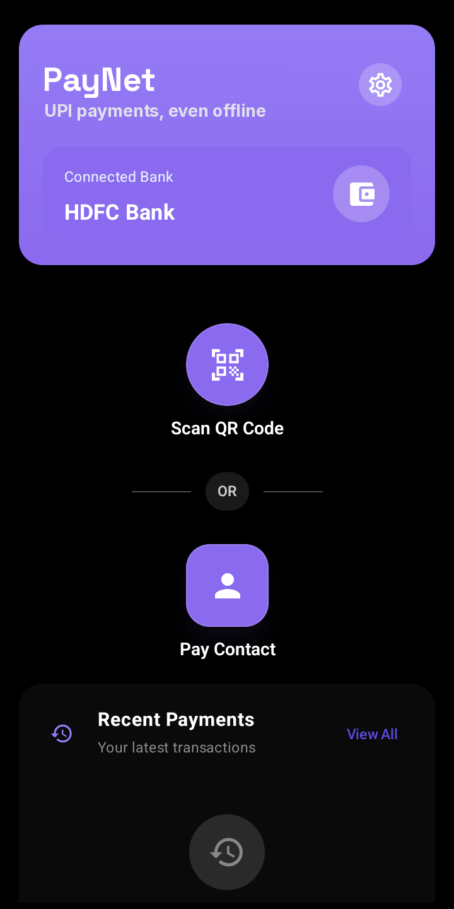

<p align="center">
  
</p>

<h3 align="center">UPI payments, even offline.</h3>

<p align="center">
  An Android app for paying over <code>*99#</code> USSD and UPI 123PAY when mobile data is gone but the cellular network is not.
</p>

<p align="center">
  <a href="https://github.com/rajarshidattapy/paynet/actions/workflows/build.yml"></a>
  <a href="LICENSE"></a>
  
  
</p>

---

Mobile data drops. UPI apps stop at the login screen. The phone can still place a call, and India's offline payment rails still work — PayNet is the interface that gets you to them.

No account. No wallet. No data connection. Scan a QR code or pick a contact, and PayNet walks the payment through your bank's own USSD or voice flow while an on-screen guide keeps the steps in view.

<p align="center">
  
</p>

## What it does

- **Scan QR → `*99#` USSD.** Point the camera at any UPI QR code and follow the bank's payment menu in the dialler.
- **Pay Contact → UPI 123PAY.** Choose a contact or paste a number, enter the amount, and complete the call-based IVR flow with the on-screen guide alongside.
- **Two rails, one fallback.** `*99#` is unavailable on Jio; the phone-number route uses UPI 123PAY, including on Jio where supported. Availability still depends on your bank and operator, so setup checks both.
- **On-device history.** Bank confirmation messages matched during an active payment window supply the outcome. Records stay on your phone — nothing is uploaded.

Your bank handles the money. PayNet never holds funds and never sees your UPI PIN — that is entered only in the bank's dialler or IVR.

## Why it exists

A declined transaction and a payment that never starts are different problems. India already has payment services that work without mobile data — `*99#` over USSD and UPI 123PAY over a voice call — but finding the right menu, in the right order, mid-payment, is where people give up. PayNet owns that last mile: recipient selection, QR scanning, step guidance and outcome matching, while the bank's flow does the banking.

## Engineering notes

**The app does not own the whole flow.** USSD menus and voice calls run outside the app. The hand-off to the dialler is unavoidable, so PayNet provides an on-screen guide during calls. It does not use an accessibility service to read or control another app.

**A call ending is not a payment confirmation.** Neither rail gives a reliable success callback. Incoming bank messages are matched only during an active payment window, duplicate messages do not create duplicate results, and a missing confirmation never becomes an assumed outcome.

**History stays on the device.** Payment records live in a local SQLite database in the app's data directory. At-rest encryption (SQLCipher with an Android Keystore-protected key) is not yet carried over to the Python build — see [docs/SECURITY.md](docs/SECURITY.md).

**Your PIN stays with your bank.** Enter it in the bank's USSD or call flow. PayNet does not read or store it.

## Running it

You need Python 3.11 or later.

```sh
git clone https://github.com/rajarshidattapy/paynet.git
cd paynet/app
python -m pip install -r requirements.txt
python main.py               # launch the app in a desktop window
python -m pytest tests -q    # run the test suite
```

On desktop, everything that needs a phone (USSD dialling, the IVR call, SMS reception, camera, the overlay during a call) is replaced by a stand-in, so no real payment is ever triggered. Each `render_*.py` script in `app/` renders one screen headlessly so you can check it visually.

## Running it on an Android phone

The packaging exists (`app/buildozer.spec`, a manifest hook, a Java SMS
receiver and pyjnius bindings) but **has never been built or run on a
device**, so expect to debug the first build. Buildozer only runs on Linux or
macOS; on Windows use WSL2 with Ubuntu.

Turn on Developer options and USB debugging on the phone, plug it in, keep it
unlocked, and run this from PowerShell at the repo root:

```powershell
.\scripts\android\build-and-install.ps1
```

It sets up WSL (apt packages, JDK), builds with buildozer inside WSL, and
installs and launches the APK with `adb`. The first run downloads the Android
SDK and NDK (several GB, 20-60 minutes) and asks you to accept the SDK
licenses; add `-SkipSetup` on later runs, or `-NoInstall` to build only. The
build runs from a copy in the Linux filesystem (`~/paynet-build`), because
builds on mounted Windows drives are slow and trip over file permissions, and
it pins Python 3.11 with `uv` (buildozer's toolchain does not work with the
Python 3.14 that recent Ubuntu releases ship). The APK is copied back to
`app/bin/`.

To install an APK without a cable, send it to the phone and open it, allowing
installs from that source when asked.

On first launch grant Phone, SMS, Camera, Contacts and Notifications, and
allow "Display over other apps". On Android 13+ a sideloaded app's SMS
permission is blocked until you open App info, tap the three-dot menu and
choose "Allow restricted settings". Python logs show up with
`adb logcat -s python`. If the SDK download fails on API 36, `android.api` in
`buildozer.spec` is the setting to lower (`app/tests/test_packaging.py` pins
it to 36 for parity with the Kotlin app, so change both).

You need **Android 10 or later**, an **Indian SIM linked to a UPI-enabled bank
account**, and cellular coverage with support for your chosen route.

Known limits of the current build: the in-call guidance overlay is not started
by any flow yet, payment history is stored unencrypted, and the debug APK is
signed with the public Android debug key, so do not distribute it (see
[docs/SECURITY.md](docs/SECURITY.md)).

## Reading the code

Python and Kivy, stdlib `sqlite3` for persistence. The app is the `paynet` package under `app/`. Start here:

| File | What to look for |
| :--- | :--- |
| [`payment/call_string.py`](app/paynet/payment/call_string.py) | Recipient and amount validation before constructing the call's DTMF string. |
| [`payment/session.py`](app/paynet/payment/session.py) | Payment lifecycle and state transitions (`PaymentSessionManager`). |
| [`telephony/call_manager.py`](app/paynet/telephony/call_manager.py) | Dialler interaction, call state and audio restoration, behind a fakeable `PhonePlatform`. |
| [`overlay/service.py`](app/paynet/overlay/service.py) | The on-screen guide during a call. |
| [`sms/pipeline.py`](app/paynet/sms/pipeline.py) | Matching bank SMS to the active payment window, with de-duplication. |

More detail lives in [docs/ARCHITECTURE.md](docs/ARCHITECTURE.md) and [docs/TESTING.md](docs/TESTING.md).

## Security

PayNet touches payment flows, USSD dialling and SMS parsing. **Do not file public issues for vulnerabilities** — see [docs/SECURITY.md](docs/SECURITY.md) for the reporting address, supported versions and the data-handling threat model.

## License

Apache License 2.0 — see [LICENSE](LICENSE). PayNet is an independent project, not affiliated with NPCI, any bank or any telecom operator.
